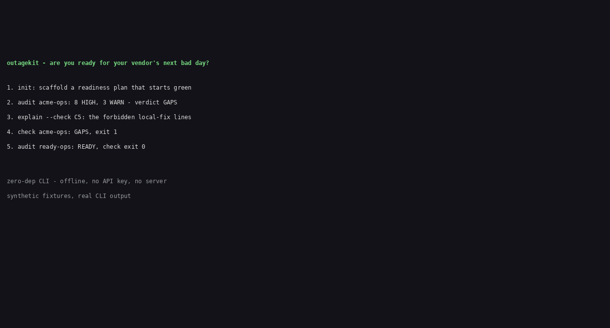

# outagekit

Audit your vendor-outage readiness from your own runbooks. For IT ops and engineering teams who depend on a critical vendor. One command shows whether your team is ready for your biggest vendor's next bad day.



## Why this exists

In November 2026 the largest enterprise vendor in the world could not fix its own outage on the first attempt. Microsoft 365 went down on 12 November 2026 and stayed degraded for more than a day. The facts below are Microsoft's own published words (Microsoft Service Health, status.cloud.microsoft, verified 2026-11-14):

- Exchange Online (EX1550543) opened 16:17 UTC 12 November 2026; the wider Microsoft 365 incident (MO1550821) followed about 2 hours later. Both affected Outlook, Teams, SharePoint, Exchange Online and Copilot.
- Microsoft: many servers became "unexpectedly unavailable" after failing automated health checks; workload shifted to the remaining servers and overloaded them. Not a traffic surge. No sign of cyberattack.
- The first fix did not take effect as expected: Microsoft's own wording was "the change is not taking effect as expected".
- Update 17:57 UTC 13 November 2026: "This was a technical issue not related to cyber or AI / agents. The incident was introduced by an issue during an earlier network capacity upgrade that surfaced following a recent network change. We have addressed the underlying issue and continue to restore service to remaining customers and regions."
- Microsoft extended the email timeout window to 48 hours during the incident.
- Final update 04:17 UTC 14 November 2026: MO1550821 reads "serviceRestored", recovery confirmed across previously affected environments; end time given as 16:10 UTC 13 November 2026. The full post-incident report has not yet been published.

While Microsoft worked, every customer at once had no self-fix: no local setting to change, no server to restart, nothing to do but wait. The operator's question is not "why did Microsoft fail". It is: when MY critical vendor goes down next, is my team ready? Do we know the vendor status page is step 1 of the runbook? Is there a fallback channel that was actually tested? Is there an escalation that does not depend on the down vendor? Is there a comms template that states only the vendor's published cause? Does anyone know the mail timeout window?

Status monitors tell you the vendor IS down. Incident platforms run the incident once it starts. Neither answers, from your own files, whether your readiness plan is complete BEFORE the incident. outagekit does that, locally, in one command.

## Quickstart

Not published on npm yet - install from source:

```sh
git clone https://github.com/techdevfun/outagekit.git
cd outagekit
npm install
npm run build
npm link   # or: node dist/cli.js ...
```

Golden path (measured 0.4 s end to end with a fast connection - each audit/check does live C2 HEAD requests, so the time is network-dependent):

```sh
outagekit init                # scaffold outagekit.json + runbook + template
outagekit audit .             # report - always exits 0
outagekit check .             # CI gate - exit 0 READY, 1 GAPS, 2 NOT-READY
```

## Worked example

Real CLI output on the synthetic fixtures in `examples/` (invented company, invented dates - verdicts are the fixtures' own):

```text
$ outagekit audit examples/acme-ops
outagekit audit - examples/acme-ops
verdict: GAPS  (CRITICAL 0, HIGH 8, WARN 3)

check name              result     severity  evidence
----------------------------------------------------------------------------------------------------
C1    STATUS-PAGE       WARN       WARN      [Stripe] important vendor "Stripe" has no statusPageUrl configured
C2    STATUS-PAGE-LIVE  PASS       -
C3    RUNBOOK-EXISTS    PASS       -
C4    RUNBOOK-STEP-1    FAIL       HIGH      [Microsoft 365] runbook does not name the status page URL in its first 40 l... (runbooks/microsoft-365.md:1)
C5    NO-LOCAL-FIX      FAIL       HIGH      [Microsoft 365] forbidden local-fix step: "reinstall" (runbooks/microsoft-365.md:12)
                                   HIGH      [Microsoft 365] forbidden local-fix step: "reset the password" (runbooks/microsoft-365.md:14)
                                   HIGH      [Microsoft 365] forbidden local-fix step: "re-create the mailbox" (runbooks/microsoft-365.md:14)
C6    FALLBACK-CHANNEL  WARN       WARN      fallback channel last tested 201 days ago (limit 90 days)
C7    ESCALATION        FAIL       HIGH      primary and backup escalation use the same channel ("phone") - one dead cha...
C8    COMMS-TEMPLATE    FAIL       HIGH      comms template has no {{vendor_cause}} placeholder - it cannot state only t... (templates/staff-announcement.md)
                                   HIGH      template asserts a cause of its own ("was caused by") instead of the vendor... (templates/staff-announcement.md:5)
                                   HIGH      template asserts a cause of its own ("root cause is") instead of the vendor... (templates/staff-announcement.md:6)
C9    MAIL-TIMEOUT      PASS       -
C10   DRILL             WARN       WARN      last full vendor-outage drill was 197 days ago (limit 180 days)

summary: 0 CRITICAL, 8 HIGH, 3 WARN, 0 UNCHECKED, 0 SKIPPED
```

```text
$ outagekit explain examples/acme-ops --check C5
explain C5 - NO-LOCAL-FIX
result: FAIL  (verdict GAPS)

rule: The runbook contains no forbidden local-fix step (reinstall / rebuild / reset password or credentials / change
      DNS records / re-create the mailbox or profile). A negation (do not / never) before a phrase in the same
      clause is not a hit; a phrase after a clause break (comma, semicolon, but) is still flagged. The per-runbook
      allowlist covers documented exceptions.

findings (3):
  [HIGH] forbidden local-fix step: "reinstall" (runbooks/microsoft-365.md:12)
      evidence: Step 3: Reinstall Outlook to fix the mailbox.
  [HIGH] forbidden local-fix step: "reset the password" (runbooks/microsoft-365.md:14)
      evidence: Step 4: Reset the password and re-create the mailbox.
  [HIGH] forbidden local-fix step: "re-create the mailbox" (runbooks/microsoft-365.md:14)
      evidence: Step 4: Reset the password and re-create the mailbox.

how to fix: Remove the local-fix step. A vendor outage has no local fix: no reinstall, no rebuild, no password
reset, no DNS change, no mailbox re-creation. If the step is a documented exception, add the exact phrase to
the runbook allowlist in outagekit.json.
```

```text
$ outagekit check examples/ready-ops
outagekit audit - examples/ready-ops
verdict: READY  (CRITICAL 0, HIGH 0, WARN 0)

check name              result     severity  evidence
----------------------------------------------------------------------------------------------------
C1    STATUS-PAGE       PASS       -
C2    STATUS-PAGE-LIVE  PASS       -
C3    RUNBOOK-EXISTS    PASS       -
C4    RUNBOOK-STEP-1    PASS       -
C5    NO-LOCAL-FIX      PASS       -
C6    FALLBACK-CHANNEL  PASS       -
C7    ESCALATION        PASS       -
C8    COMMS-TEMPLATE    PASS       -
C9    MAIL-TIMEOUT      PASS       -
C10   DRILL             PASS       -

summary: 0 CRITICAL, 0 HIGH, 0 WARN, 0 UNCHECKED, 0 SKIPPED

check: READY (exit 0)
```

## Commands

| Command | What it does | Exit code |
|---|---|---|
| `outagekit init [--dir <dir>]` | Scaffold `outagekit.json` + a correct example runbook + staff template. Refuses to overwrite an existing manifest. | 0 (2 if the manifest already exists) |
| `outagekit audit <dir> [--config <file>] [--format table\|json]` | Print the readiness report. JSON carries per-check findings with file + line, never file contents beyond the matched line. | 0 always (2 on config error) |
| `outagekit check <dir> [--config <file>] [--max-warn N]` | CI gate. Prints failing checks first. `--max-warn N` fails (exit 1) when WARN count exceeds N. | 0 READY, 1 GAPS, 2 NOT-READY or config error |
| `outagekit explain <dir> --check <id>` | Why this check scored this way: the rule, every finding with file:line, and how to fix it. | 0 |
| `outagekit diff --baseline <file> <dir>` | Compare against a saved `audit --format json` baseline: NEW / FIXED / STILL-OPEN findings. | 0 (1 when a CRITICAL or HIGH finding is NEW vs baseline) |

## Checks

| # | Check | Rule (v0.1.0) | Severity when failing |
|---|-------|---------------|----------------------|
| C1 | STATUS-PAGE | Every critical vendor has a `statusPageUrl` configured (important vendors: WARN when missing) | CRITICAL (WARN for important) |
| C2 | STATUS-PAGE-LIVE | HEAD request to the configured status page URL returns 2xx/3xx. GET retry when HEAD is refused (401/403/405) - Microsoft's status page answers HEAD with 401 and GET with 200. Offline pages report UNCHECKED, never PASS | WARN (only when reachable and failing) |
| C3 | RUNBOOK-EXISTS | A runbook file exists for every critical vendor (or the shared runbook names the vendor) | CRITICAL |
| C4 | RUNBOOK-STEP-1 | The runbook names the vendor's status page URL within its first 40 lines | HIGH |
| C5 | NO-LOCAL-FIX | The runbook contains no forbidden local-fix step (reinstall / rebuild / reset password or credentials / change DNS records / re-create the mailbox or profile). Each hit is reported with line + phrase. A negation ("do not", "never") before a phrase in the same clause is not a hit; a phrase after a clause break is still flagged. Per-runbook allowlist covers documented exceptions. C5 is a heuristic, not a proof. | HIGH |
| C6 | FALLBACK-CHANNEL | A fallback comms channel is defined on a channel that does NOT depend on any listed vendor, and `lastTested` is within 90 days | HIGH if missing; WARN if stale |
| C7 | ESCALATION | Primary + backup escalation contacts defined, on different channels, and not the same person | HIGH |
| C8 | COMMS-TEMPLATE | Staff-announcement template exists, contains a `{{vendor_cause}}` placeholder (state only the vendor's published cause), and asserts no root cause of its own (one finding per claim) | HIGH |
| C9 | MAIL-TIMEOUT | Mail timeout / retry window is documented (runbook or manifest) and at least 24h | WARN |
| C10 | DRILL | Last full vendor-outage drill within 180 days | WARN if stale/missing |

Verdicts: `READY` (exit 0 - no HIGH/CRITICAL findings), `GAPS` (exit 1 - HIGH findings, no CRITICAL), `NOT-READY` (exit 2 - any CRITICAL finding). WARN findings never change the exit code alone. Config errors (unreadable manifest, missing file) exit 2 with a plain error message.

Thresholds (`fallbackTestMaxDays` 90, `drillMaxDays` 180, `mailTimeoutMinHours` 24) are defaults chosen by the author, published in `outagekit.json`, and overridable per repo. They are not industry standards, and no standard is cited for them.

## Config

`outagekit.json` (scaffolded by `init`):

```json
{
  "version": 1,
  "vendors": [
    { "name": "Microsoft 365", "statusPageUrl": "https://status.cloud.microsoft/m365",
      "runbook": "runbooks/microsoft-365.md", "criticality": "critical" }
  ],
  "fallbackChannel": { "type": "sms", "name": "SMS broadcast group", "lastTested": "2026-11-14" },
  "escalation": {
    "primary": { "name": "On-call lead", "channel": "phone" },
    "backup": { "name": "Duty manager", "channel": "sms" }
  },
  "commsTemplate": "templates/staff-announcement.md",
  "mailTimeoutHours": 48,
  "lastDrill": "2026-11-14",
  "thresholds": { "fallbackTestMaxDays": 90, "drillMaxDays": 180, "mailTimeoutMinHours": 24 },
  "allowlist": { "runbooks/microsoft-365.md": ["rebuild"] }
}
```

Runbooks: one markdown file per critical vendor, or one shared `runbooks/vendor-outage-runbook.md` that names every critical vendor. Either layout is accepted and reported.

Contact privacy: escalation contacts are names + channel TYPES only. A manifest that puts a phone number or email address in an escalation contact is refused at load time, and evidence lines in output are redacted for email addresses and phone-like digit runs. Phone numbers and email addresses are never printed or stored in output.

Data control: outagekit reads runbook text and the manifest only. It never reads secret values or env values, and never reads files matching `.env*`, `*secret*`, `*.pem` or `*.key`. Runbooks are resolved only from paths named in the manifest (plus the shared runbook); a manifest path matching one of those patterns is treated as missing and never read.

## Alternatives (verified 2026-11-14)

| Tool | What it does | What it does not do (our wedge) |
|---|---|---|
| Atlassian Statuspage (statuspage.io) | The canonical place a vendor announces an outage; the URL outagekit checks is usually a Statuspage URL | Tells you the vendor is down - never audits whether YOUR runbook, fallback channel or escalation is ready |
| Better Stack / UptimeRobot | Uptime + status monitoring for your services and third-party status pages, with alerting | Monitoring is not readiness - no runbook audit, no fallback freshness, no comms-template check, no CI gate on the plan |
| incident.io / PagerDuty / Rootly | Incident management SaaS: declare, page, run and review incidents | They start when the incident starts; none reads your repo and audits in advance whether the plan they will execute is complete |
| OutagePulse (outagepulse.com) | Kubernetes observability your AI agent reads over MCP (eBPF, DaemonSet, grounded RCA) | Debugs YOUR outage after it happens; never audits your readiness plan for a VENDOR outage, and needs a cluster where outagekit needs only files |
| HA/DR Field Kit (kit.reliabilityops.dev) | Browser checklists for failover triage (databases, Applications, Incident Command, Dashboards), read-only, offline | Manual browser checklists - no vendor-outage scope, no manifest, no CI gate, no freshness tracking |
| vendormap (techdevfun, same author) | Measures vendor CONCENTRATION from the repo: which single vendor can take you down | Says nothing about whether you are ready when that vendor goes down - concentration and readiness are complementary halves, not the same tool |
| Status-page aggregators / Downdetector | Crowd reports that a vendor is down | A signal is not a plan; no audit, no gate, no evidence |

Strongest rival: incident.io + Statuspage as a pair - the pair covers "know the vendor is down" and "run the incident". Neither covers "prove, from your own files, that the plan is ready before the incident".

## Where rivals beat us

- Statuspage / Better Stack give REAL-TIME vendor status and alerts. outagekit only checks the status-page URL is configured (and, when online, reachable).
- incident.io / PagerDuty page real humans and run real incidents. outagekit never pages anyone.
- HA/DR Field Kit covers failover-triage depth (databases, Applications, Incident Command, Dashboards) outagekit never touches.
- outagekit only sees what is in the files it reads. The team's actual skill, the vendor's real recovery speed and the human judgement in the room are invisible to it.

## Honest limits

- Checks are readiness HEURISTICS over your own files, not risk measurements. A READY verdict means the plan is complete on paper, not that the next outage will go well.
- C5 (NO-LOCAL-FIX) is a phrase heuristic: it can miss a local-fix step worded differently, and it trusts the allowlist for documented exceptions.
- C2 checks that a status page answers, not that the vendor is healthy. A page can answer 200 while the vendor is down - that is what the page is for; outagekit only verifies the URL is the right one to check.
- Thresholds (90-day fallback test, 180-day drill, 24h mail timeout) are author defaults, not industry standards.
- The tool never claims a vendor is "safe" or "risky", never states a root cause beyond the vendor's published wording, and never claims an incident is "fully resolved" beyond the vendor's own "serviceRestored" wording.

## Performance

- `audit` over the 2 demo fixtures (200 runs each, liveness skipped): median 0.62 ms, p95 1.9 ms (target was p95 under 2 s). Run `npm run bench` to reproduce.
- Clean install from source (`npm install` + `npm run build`, no cache): 3.7 s, measured 2026-11-14.
- Golden path (`init` then `audit` then `check`): 0.4 s, measured 2026-11-14 with a fast connection; network-dependent (live C2 HEAD checks).

## Roadmap (out of scope for v0.1.0, not silently dropped)

- No live vendor-status monitoring, no polling, no alerting (Statuspage / Better Stack territory).
- No paging, no incident orchestration, no timeline (incident.io / PagerDuty territory).
- No auto-remediation, no runbook auto-generation, no AI-written comms (the template is human-written; the tool only audits it).
- No SLA/credit calculation, no vendor financial-health data.
- Possible later: generic webhook on NOT-READY, pre-commit hook example, enterprise rollout docs.

## Contributing

See [CONTRIBUTING.md](CONTRIBUTING.md). TypeScript strict, zero runtime dependencies, Node 20+.

## License

MIT - see [LICENSE](LICENSE).
